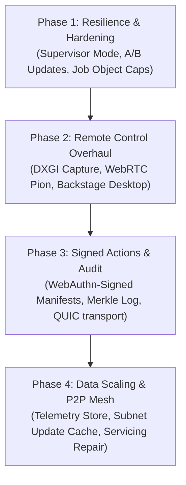

# Architectural Roadmap & Next-Gen Transformation

This document tracks the strategic architectural roadmap to transform **Homelab RMM** from a lightweight homelab tool into an enterprise-grade, resilient, zero-trust remote monitoring and management platform, guided by [`Next-Gen RMM Architecture Research.md`](Next-Gen%20RMM%20Architecture%20Research.md) and finalized through architectural stress-testing (`/grill-me`).

---

## Finalized Architectural Decisions

| Subsystem | Decision | Rationale |
| :--- | :--- | :--- |
| **Server Topology & Storage** | **Single Binary with Embedded Dual-Engine** (SQLite for OLTP + an embedded Pebble LSM for metrics, or ClickHouse for enterprise deployments). Built in Phase 4; an external PostgreSQL driver was not. | Retains zero-external-dependency simplicity for homelabs and small/medium MSPs while eliminating SQLite single-writer bottlenecks. |
| **Remote Desktop & Streaming** | **Hybrid Pipeline**: DirectX (DXGI) Desktop Duplication for GPU VRAM capture + WebRTC (Pion) P2P UDP for sub-20ms 60 FPS, with automatic fallback to server-relayed WebSockets through restrictive firewalls. | Maximizes visual fluidness and minimizes server bandwidth while guaranteeing 100% firewall traversal reliability. |
| **Zero-Trust Security (E2E-CAA)** | **Tiered & Configurable**: Optional "Zero-Trust Fleet Signing" policy requiring Ed25519/FIDO2 cryptographic Action Manifest signatures on bulk/fleet-wide scripts and destructive actions, while interactive live shells run under standard session auth. | Delivers enterprise supply-chain immunity (mitigating Kaseya-style server compromises) without introducing friction to everyday homelab terminal administration. |
| **Agent Resilience & Supervisor** | **Unified Executable with Supervisor Mode**: `rmm-agent supervisor` manages dual A/B execution slots (`slot_a` / `slot_b`), monitors worker IPC heartbeats, and triggers a 60-second post-update rollback circuit on connection failure. | Keeps distribution down to one binary per platform; eliminates bricked agent scenarios during auto-updates. |
| **Script Sandboxing & Safety** | **Configurable Job Object Ceilings**: Default 1 GB RAM cap and CPU rate quota applied to all scripts (overridable in script payload for heavy maintenance), paired with real-time regex redaction of secrets from output streams. | Prevents runaway memory leaks or fork bombs from crashing the host machine and prevents secret leakage into audit logs. |

---

## The 4-Phase Transformation Roadmap

### Phase 1: Agent Resilience & Hardening *(Completed)*
- [x] **Unified Agent Supervisor Subcommand (`rmm-agent supervisor`):**
  - OS service executes `rmm-agent supervisor`, which spawns and supervises worker `rmm-agent run` from the active slot.
  - Heartbeat monitoring over local IPC (Named Pipe on Windows / Unix Domain Socket on Linux); auto-restarts worker in <5s on crash or hang.
- [x] **Atomic A/B Slot Staging & 60s Rollback Circuit:**
  - Directory layout: `bin/slot_a/`, `bin/slot_b/`, and `bin/current` symlink / junction.
  - Self-update stages new binary into inactive slot, flips junction, and restarts worker.
  - Worker verifies authenticated C2 check-in with the server within 60 seconds; if timeout expires or worker crashes, supervisor rolls back to previous slot.
- [x] **Process Sandboxing & Resource Quotas:**
  - Windows Job Object limits (`JOB_OBJECT_LIMIT_PROCESS_MEMORY` = 1 GB default, CPU rate limit) enforced in `internal/agent/proc_windows.go`.
  - Configurable memory/CPU overrides supported in `protocol.ScriptRun`.
  - Linux process execution isolated with cgroups v2 / prlimit memory limits.
- [x] **Secret In-Memory Protection & Output Redaction:**
  - Real-time stream redactor on stdout/stderr streams sanitizing Bearer tokens, key-value secrets (`password=...`), and PEM private keys into `[REDACTED]`.

### Phase 2: Remote Control & Streaming Overhaul *(Completed, Linux Wayland capture partial)*
Plan: [`docs/plans/2026-10-01-phase2-remote-desktop-webrtc.md`](plans/2026-10-01-phase2-remote-desktop-webrtc.md). Wire protocol: [`docs/DESKTOP-PROTOCOL.md`](DESKTOP-PROTOCOL.md).
- [x] **DirectX (DXGI) Desktop Duplication:**
  - `IDXGIOutputDuplication` GPU capture with hybrid-GPU adapter matching, driver dirty/move rects and hardware cursor compositing; automatic GDI fallback (`internal/agent/desktop/capture_dxgi_windows.go`).
  - H.264 via Media Foundation (hardware MFT when present, software MFT otherwise) with in-VRAM BGRA→NV12 conversion. Verified on Intel Quick Sync; NVENC/AMF MFTs untested. AV1 not implemented.
- [x] **WebRTC (Pion) P2P Media Channels with WebSocket Fallback** *(remote desktop)*:
  - H.264 video track plus `input-unreliable`/`input-reliable` data channels, RTCP PLI/FIR → forced keyframe, JPEG-tile fast start and a 4 s fallback to the server-relayed WebSocket.
  - Not yet extended to the terminal, which still uses the WebSocket relay.
- [x] **Administrative Backstage Mode:**
  - Windows `CreateDesktopW` virtual desktop isolation on `winsta0`, off-screen `PrintWindow` compositing and `PostMessageW` input (never `GetDC(NULL)` or `SendInput`).
  - Enables technicians to perform interactive GUI and shell maintenance without taking over the logged-in user's monitor.
- [ ] **Linux Screen Streaming Modernization** *(partial)*:
  - Done: `/dev/uinput` input injection and the XDG ScreenCast portal negotiation with a persisted restore token.
  - Open: PipeWire frame ingestion needs a PipeWire client (libpipewire, i.e. CGO), so Wayland sessions still capture through the X11 / screenshot-portal path.

### Phase 3: Signed Actions & Tamper-Evident Audit *(Completed)*
Plan: [`docs/plans/2026-10-06-phase3-signed-actions.md`](plans/2026-10-06-phase3-signed-actions.md). Re-scoped on 2026-10-06: browser WebAuthn signing first and an out-of-band signer later; a local Merkle log instead of Sigstore Rekor; QUIC delivered last as an agent-only transport.
- [x] **3A Signed actions** *(implemented; not yet exercised with a real browser and security key)*: operator-signed manifests (WebAuthn: ES256/EdDSA/RS256) verified by the agent before any destructive action, shell/desktop session, or update; pinned trust bundle with quorum rotation and an offline recovery key; off → audit → enforce rollout; anti-replay by nonce, expiry and target binding. A failed check rejects and alerts, never isolates.
- [x] **3B Standing approvals:** signed, content-hash-bound approvals for unattended runs (scheduled tasks, automations, patch policies, software catalog and client portal).
- [x] **3C Transparency log** *(implemented 2026-10-24; plan [`docs/plans/2026-10-24-phase3c-transparency-log.md`](plans/2026-10-24-phase3c-transparency-log.md))*: embedded RFC 6962-style Merkle log (`golang.org/x/mod/sumdb/tlog`) with signed tree heads pinned in the trust bundle; agents verify inclusion and consistency on every protected request and keep their own executed-action log; `rmm-server log verify` checks from outside.
- [x] **3D Out-of-band signer & M-of-N** *(implemented 2026-10-24 as `rmm-signer`, native WebAuthn on Windows, not yet run against a real authenticator; plan [`docs/plans/2026-10-24-phase3d-out-of-band-signer.md`](plans/2026-10-24-phase3d-out-of-band-signer.md))*: a signer the server does not serve, closing the blind-signing gap against a fully compromised server. The native Android approval screen stays open.
- [x] **3E QUIC agent transport** *(implemented 2026-10-24; plan [`docs/plans/2026-10-24-phase3e-quic.md`](plans/2026-10-24-phase3e-quic.md))*: opt-in (`--quic`), a QUIC stream per server request to remove head-of-line blocking, automatic WebSocket fallback.

### Phase 4: Data Scaling & Local Mesh Distribution *(Completed, with the exceptions below)*
Plans: [`4A`](plans/2026-10-24-phase4a-telemetry-store.md), [`4B`](plans/2026-10-24-phase4b-mesh-cache.md), [`4C`](plans/2026-10-24-phase4c-servicing-repair.md), all implemented 2026-10-24. Not built, on purpose: multicast/mDNS discovery and an external PostgreSQL driver. ClickHouse was verified against a fake of its HTTP protocol only. None of it has run on a production fleet.
- [x] **4A Embedded Dual-Engine Storage** *(DuckDB not used; PostgreSQL not built)*:
  - `internal/telemetry`: the metrics series lives in SQLite (default), an embedded Pebble LSM (`<data dir>/telemetry`, rollups kept on ingest) or ClickHouse over its HTTP interface. `--telemetry` / `RMM_TELEMETRY`, `rmm-server telemetry migrate` and `drop-sqlite`, with a data-directory lock so the migration never races a running server. Pebble was chosen over DuckDB because it is pure Go and keeps `CGO_ENABLED=0` cross-compilation.
  - **No PostgreSQL:** the server has several hundred statements in SQLite's dialect (`INSERT OR REPLACE`, `PRAGMA`, `datetime()` arithmetic, `last_insert_rowid`), so a second OLTP engine is a rewrite of the data layer, not a driver. It is its own future phase.
  - **ClickHouse is verified against a protocol fake only** (an httptest server that checks the SQL and parameters it receives), never a real ClickHouse. Its plain MergeTree also keeps duplicate samples at one timestamp.
- [x] **4B Local Subnet Cache** *(no multicast or mDNS)*:
  - The server assigns the roles instead of the agents electing them. It already holds every device's LAN addresses and online state, and a multicast election would add a discovery protocol, a second trust problem and a failure mode on networks that block multicast. One leader per organization and subnet, re-assigned every 60 s and on every online/offline event.
  - The leader keeps a content-addressable store (2 MiB chunks, each verified against an index) and serves it over HTTPS and HTTP/3 behind a daily HMAC token and a pinned certificate. Members verify the whole file against the SHA-256 the server named and fall back to the origin. Today it carries the agent binary through `selfUpdate`. The chunks are checked against an index the leader serves, not a Merkle tree; the whole-file hash is what the trust rests on.
  - Windows updates and winget downloads are out of scope: they come from Microsoft's CDN, where Delivery Optimization already peers on the LAN.
  - The settings switch is global, not per organization; the update source reaches the agent log but not yet the console (`update.go` discards the reply).
- [x] **4C Autonomous Windows Servicing Repair:**
  - `servicing.repair` is a signed `ClassAction` running `dism_restore`, `sfc`, `reset_components`, `add_package` and `rescan` in canonical order, each hidden, timed out and tailed. `reset_components` renames `SoftwareDistribution` and `catroot2` instead of deleting them.
  - `patch_policies.repair = auto` starts one repair per device per 24 hours when a scan or install carries one of the known servicing codes, under a standing approval unit (purpose `repair`) that binds the steps and the reboot mode and never covers a package. Records, audit rows and `event` alerts included; the device page can run it by hand.
  - CBS package injection (`add_package`) is manual only. The repair commands were tested through a fake executor, not on a damaged machine.

---

## Long-Term Platform Capabilities

### 5. Native Endpoint & Cloud Backup
- **Scope**: File & folder backup, full-disk image backup, bare-metal disaster recovery.
- **Storage**: S3-compatible cloud storage (MinIO, Wasabi, AWS S3, B2) & local SMB/NFS. Client-side AES-256 and deduplication.

### 6. Mobile Device Management (MDM) & Apple Ecosystem
- **Scope**: Native Apple MDM (macOS, iOS, iPadOS) and Android Enterprise.
- **Integration**: Apple Push Notification service (APNs), Apple Business Manager (ABM), Android Enterprise Device Owner.

### 7. Commercial EDR & Managed Antivirus Orchestration
- **Scope**: Centralized policy enforcement, definition distribution, and alert feeds from commercial EDR (CrowdStrike, SentinelOne, Defender for Endpoint).

### 8. Zero-Knowledge IT Documentation & Credential Vault
- **Scope**: Integrated client-side encrypted credential vault (IT Glue / Hudu style) with automatic credential injection into remote sessions.
