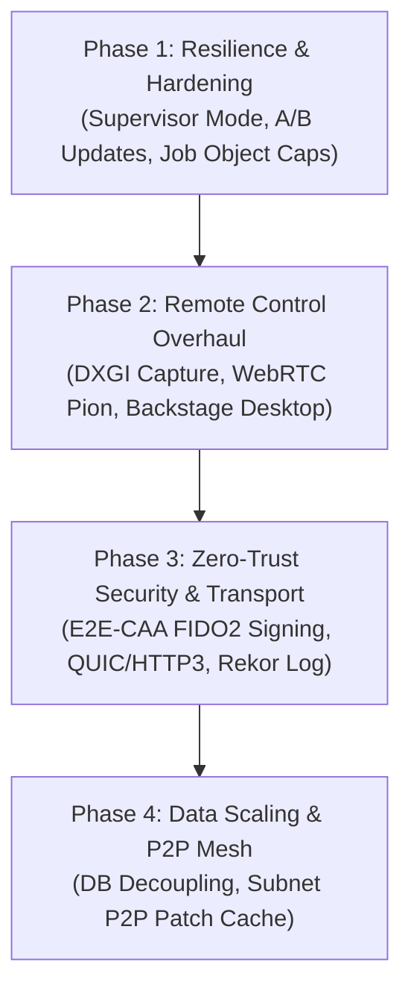

# Architectural Roadmap & Next-Gen Transformation

This document tracks the strategic architectural roadmap to transform **Homelab RMM** from a lightweight homelab tool into an enterprise-grade, resilient, zero-trust remote monitoring and management platform, guided by [`Next-Gen RMM Architecture Research.md`](Next-Gen%20RMM%20Architecture%20Research.md) and finalized through architectural stress-testing (`/grill-me`).

---

## Finalized Architectural Decisions

| Subsystem | Decision | Rationale |
| :--- | :--- | :--- |
| **Server Topology & Storage** | **Single Binary with Embedded Dual-Engine** (SQLite for OLTP + embedded columnar/TSDB like DuckDB for metrics), with optional external PostgreSQL/ClickHouse drivers for enterprise deployments. | Retains zero-external-dependency simplicity for homelabs and small/medium MSPs while eliminating SQLite single-writer bottlenecks. |
| **Remote Desktop & Streaming** | **Hybrid Pipeline**: DirectX (DXGI) Desktop Duplication for GPU VRAM capture + WebRTC (Pion) P2P UDP for sub-20ms 60 FPS, with automatic fallback to server-relayed WebSockets through restrictive firewalls. | Maximizes visual fluidness and minimizes server bandwidth while guaranteeing 100% firewall traversal reliability. |
| **Zero-Trust Security (E2E-CAA)** | **Tiered & Configurable**: Optional "Zero-Trust Fleet Signing" policy requiring Ed25519/FIDO2 cryptographic Action Manifest signatures on bulk/fleet-wide scripts and destructive actions, while interactive live shells run under standard session auth. | Delivers enterprise supply-chain immunity (mitigating Kaseya-style server compromises) without introducing friction to everyday homelab terminal administration. |
| **Agent Resilience & Supervisor** | **Unified Executable with Supervisor Mode**: `rmm-agent supervisor` manages dual A/B execution slots (`slot_a` / `slot_b`), monitors worker IPC heartbeats, and triggers a 60-second post-update rollback circuit on connection failure. | Keeps distribution down to one binary per platform; eliminates bricked agent scenarios during auto-updates. |
| **Script Sandboxing & Safety** | **Configurable Job Object Ceilings**: Default 1 GB RAM cap and CPU rate quota applied to all scripts (overridable in script payload for heavy maintenance), paired with real-time regex redaction of secrets from output streams. | Prevents runaway memory leaks or fork bombs from crashing the host machine and prevents secret leakage into audit logs. |

---

## The 4-Phase Transformation Roadmap

### Phase 1: Agent Resilience & Hardening *(Completed)*
- [x] **Unified Agent Supervisor Subcommand (`rmm-agent supervisor`):**
  - OS service executes `rmm-agent supervisor`, which spawns and supervises worker `rmm-agent run` from the active slot.
  - Heartbeat monitoring over local IPC (Named Pipe on Windows / Unix Domain Socket on Linux); auto-restarts worker in <5s on crash or hang.
- [x] **Atomic A/B Slot Staging & 60s Rollback Circuit:**
  - Directory layout: `bin/slot_a/`, `bin/slot_b/`, and `bin/current` symlink / junction.
  - Self-update stages new binary into inactive slot, flips junction, and restarts worker.
  - Worker verifies authenticated C2 check-in with the server within 60 seconds; if timeout expires or worker crashes, supervisor rolls back to previous slot.
- [x] **Process Sandboxing & Resource Quotas:**
  - Windows Job Object limits (`JOB_OBJECT_LIMIT_PROCESS_MEMORY` = 1 GB default, CPU rate limit) enforced in `internal/agent/proc_windows.go`.
  - Configurable memory/CPU overrides supported in `protocol.ScriptRun`.
  - Linux process execution isolated with cgroups v2 / prlimit memory limits.
- [x] **Secret In-Memory Protection & Output Redaction:**
  - Real-time stream redactor on stdout/stderr streams sanitizing Bearer tokens, key-value secrets (`password=...`), and PEM private keys into `[REDACTED]`.

### Phase 2: Remote Control & Streaming Overhaul *(Completed, Linux Wayland capture partial)*
Plan: [`docs/plans/2026-10-01-phase2-remote-desktop-webrtc.md`](plans/2026-10-01-phase2-remote-desktop-webrtc.md). Wire protocol: [`docs/DESKTOP-PROTOCOL.md`](DESKTOP-PROTOCOL.md).
- [x] **DirectX (DXGI) Desktop Duplication:**
  - `IDXGIOutputDuplication` GPU capture with hybrid-GPU adapter matching, driver dirty/move rects and hardware cursor compositing; automatic GDI fallback (`internal/agent/desktop/capture_dxgi_windows.go`).
  - H.264 via Media Foundation (hardware MFT when present, software MFT otherwise) with in-VRAM BGRA→NV12 conversion. Verified on Intel Quick Sync; NVENC/AMF MFTs untested. AV1 not implemented.
- [x] **WebRTC (Pion) P2P Media Channels with WebSocket Fallback** *(remote desktop)*:
  - H.264 video track plus `input-unreliable`/`input-reliable` data channels, RTCP PLI/FIR → forced keyframe, JPEG-tile fast start and a 4 s fallback to the server-relayed WebSocket.
  - Not yet extended to the terminal, which still uses the WebSocket relay.
- [x] **Administrative Backstage Mode:**
  - Windows `CreateDesktopW` virtual desktop isolation on `winsta0`, off-screen `PrintWindow` compositing and `PostMessageW` input (never `GetDC(NULL)` or `SendInput`).
  - Enables technicians to perform interactive GUI and shell maintenance without taking over the logged-in user's monitor.
- [ ] **Linux Screen Streaming Modernization** *(partial)*:
  - Done: `/dev/uinput` input injection and the XDG ScreenCast portal negotiation with a persisted restore token.
  - Open: PipeWire frame ingestion needs a PipeWire client (libpipewire, i.e. CGO), so Wayland sessions still capture through the X11 / screenshot-portal path.

### Phase 3: Zero-Trust Security & Modernized Transport
- [ ] **End-to-End Cryptographic Action Authorization (E2E-CAA):**
  - Standardize on RFC 8785 Canonical JSON Action Manifests for all fleet-wide scripts and destructive actions.
  - Hardware-backed Ed25519 signing (FIDO2 / WebAuthn) for administrative commands; M-of-N multi-party authorization for high-risk actions.
  - Agent-side signature and anti-replay nonce verification against local TPM/keystores.
- [ ] **Immutable Transparency Audit Log:**
  - Integration with Sigstore Rekor append-only transparency log proofs to ensure non-repudiation.
- [ ] **QUIC / HTTP/3 Transport Upgrade:**
  - Migrate from Gorilla WebSocket over TCP (`internal/agent/conn.go`) to HTTP/3 & QUIC over UDP port 443.
  - 64-bit Connection IDs for uninterrupted connection migration across roaming Wi-Fi/cellular transitions.

### Phase 4: Data Scaling & Local Mesh Distribution
- [ ] **Embedded Dual-Engine Storage:**
  - Integrate embedded columnar/time-series store (DuckDB / Pebble) for high-frequency agent telemetry, freeing SQLite for transactional OLTP.
  - Provide optional external PostgreSQL and ClickHouse drivers for enterprise deployments.
- [ ] **Local Subnet P2P Mesh Caching:**
  - LAN discovery via mDNS / UDP multicast for managed agents on the same subnet.
  - Dynamic subnet leader election to download OS updates and software packages once across the WAN.
  - Content-Addressable Storage (CAS) with 2 MB chunks verified by Merkle trees, shared locally over HTTP/3.
- [ ] **Autonomous Windows Servicing Repair:**
  - Auto-remediation on catalog corruption (`0x80240020`): automated `DismRestoreHealth`, `catroot2` / `SoftwareDistribution` purges.
  - Direct CBS store package injection via `DismAddPackage` to bypass damaged WUA engines.

---

## Long-Term Platform Capabilities

### 5. Native Endpoint & Cloud Backup
- **Scope**: File & folder backup, full-disk image backup, bare-metal disaster recovery.
- **Storage**: S3-compatible cloud storage (MinIO, Wasabi, AWS S3, B2) & local SMB/NFS. Client-side AES-256 and deduplication.

### 6. Mobile Device Management (MDM) & Apple Ecosystem
- **Scope**: Native Apple MDM (macOS, iOS, iPadOS) and Android Enterprise.
- **Integration**: Apple Push Notification service (APNs), Apple Business Manager (ABM), Android Enterprise Device Owner.

### 7. Commercial EDR & Managed Antivirus Orchestration
- **Scope**: Centralized policy enforcement, definition distribution, and alert feeds from commercial EDR (CrowdStrike, SentinelOne, Defender for Endpoint).

### 8. Zero-Knowledge IT Documentation & Credential Vault
- **Scope**: Integrated client-side encrypted credential vault (IT Glue / Hudu style) with automatic credential injection into remote sessions.
