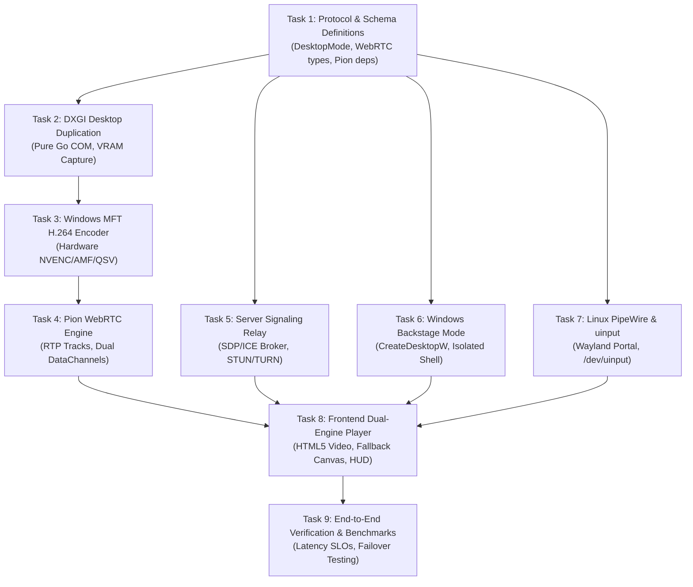

# Phase 2 Implementation Plan: Remote Control & Streaming Overhaul

**Document:** `docs/plans/2026-10-01-phase2-remote-desktop-webrtc.md`  
**Status:** Approved & Ready for Execution  
**Goal:** Transform `homelab-rmm` remote desktop from a CPU-bound 20 FPS GDI BitBlt / WebSocket JPEG tile relay into a sub-20ms 60 FPS hardware-accelerated remote control engine featuring DirectX (DXGI) Desktop Duplication, WebRTC (Pion) P2P media channels with automatic WebSocket fallback, Windows Backstage Mode virtual desktop isolation, and Linux PipeWire/Wayland modernization with `/dev/uinput` injection.

---

## 1. Executive Summary & Architectural Objectives

The Phase 2 overhaul addresses the visual fluidity, latency, resource consumption, and administrative flexibility gaps identified in [`docs/Next-Gen RMM Architecture Research.md`](../Next-Gen%20RMM%20Architecture%20Research.md) and [`docs/ROADMAP.md`](../ROADMAP.md):

1. **GPU VRAM Capture via DXGI Desktop Duplication**: Replace CPU-intensive GDI `BitBlt` screen scraping with `IDXGIOutputDuplication`. Access desktop frame surfaces directly in GPU memory, utilize driver-supplied dirty/move rectangles to eliminate CPU pixel diffing, and capture the hardware mouse pointer.
2. **Sub-20ms 60 FPS WebRTC (Pion) P2P Media & Data Channels**: Stream video frames over UDP via WebRTC SRTP tracks with hardware-accelerated H.264/HEVC encoding (Windows Media Foundation MFT) and route mouse/keyboard input across WebRTC SCTP DataChannels. Exchange SDP/ICE candidates over the existing WebSocket C2 bridge, with an automatic 4-second fallback to the existing server-relayed WebSocket tile stream when corporate firewalls block UDP.
3. **True Non-Intrusive Windows Backstage Mode**: Enable technicians to troubleshoot endpoints without taking over the physical monitor or interrupting the logged-in user. Create an isolated Win32 virtual desktop (`CreateDesktopW`) on `winsta0` and spawn administrative shells (`powershell.exe`, `cmd.exe`, Task Manager) on this private surface.
4. **Linux Display Capture Modernization**: Support Wayland screen capture via XDG Desktop Portals (`org.freedesktop.portal.ScreenCast`) and PipeWire, while retaining X11 MIT-SHM compatibility. Implement universal input injection via `/dev/uinput` leveraging root agent daemon privileges.
5. **Dual-Engine Frontend Player**: Upgrade `web/src/pages/device/Desktop.tsx` with an HTML5 `<video>` element for hardware-decoded WebRTC playback and a synchronized `<canvas>` for WebSocket tile fallback, complete with real-time stream diagnostics (FPS, RTT, bitrate, transport mode).

---

## 2. Existing Codebase Audit & Gap Analysis

### 2.1 Agent Desktop Package (`internal/agent/desktop/`)

| File | Current Implementation | Architectural Gaps & Bottlenecks |
| :--- | :--- | :--- |
| `capture.go` | Wraps `github.com/kbinani/screenshot`, calling `screenshot.CaptureRect(m.Bounds)`. | **High CPU Overhead:** On Windows, `kbinani/screenshot` calls GDI `CreateCompatibleDC` and `BitBlt` every frame. Transfers whole-screen bitmaps from GPU to system RAM over PCI-e.<br>**Invisible Mouse:** GDI `BitBlt` strips the hardware mouse cursor; remote pointers are completely invisible.<br>**No 3D Support:** Cannot capture hardware-accelerated DirectX/OpenGL fullscreen surfaces.<br>**Hardcoded Rate:** Enforces ~20 FPS limit (`minFrameInterval = 50 * time.Millisecond`). |
| `tiles.go` | Divides 1080p frame into 64×64 pixel grid (`tileSize = 64`). Performs byte-by-byte comparison (`tileChanged`) across consecutive `image.RGBA` buffers and merges rectangular runs up to 256px high. | **CPU Burn:** Compares ~8.3 MB per 1080p frame in pure Go software on every tick. At 60 FPS this would consume 500 MB/s of memory bandwidth and 30-50% CPU.<br>**Redundant Work:** Display drivers already know dirty areas; software diffing is redundant when DXGI metadata is available. |
| `session.go` | Runs 4 goroutines (`readLoop`, `pingLoop`, `inputLoop`, `captureLoop`). Encodes changed rectangles to JPEG in parallel via `sync.Pool` and `image/jpeg.Encode`. Enforces `maxInflight = 2` unacknowledged frames via WebSocket ACK flow control. | **High Encoding Latency:** Software JPEG encoding takes 15–35ms per frame on multi-core CPUs, capping practical framerates.<br>**Bandwidth Inefficiency:** M-JPEG tile streaming consumes 5–15 Mbps for active motion compared to 1–2 Mbps for H.264/HEVC. |
| `platform_windows.go` | Resolves DPI awareness via `SetProcessDpiAwarenessContext`. `threadDesktop.follow()` polls `OpenInputDesktop` and `SetThreadDesktop` before each capture/injection to track desktop switches (`Default` ↔ `Winlogon`). | **Console-Only Binding:** Assumes the helper must always track the active input desktop. Lacks support for creating or attaching to background virtual desktops (`CreateDesktopW`). |
| `launch_windows.go` | `launch()` finds console session via `WTSGetActiveConsoleSessionId()`, duplicates SYSTEM token with `TokenSessionId`, and calls `CreateProcessAsUser` targeting `winsta0\default`. | **Missing Backstage Launcher:** Cannot launch a helper or background admin shells into a dedicated administrative desktop. |
| `launch_linux.go` & `platform_linux.go` | Scans `loginctl list-sessions` for `Type=x11`. Spawns helper as logged-in user with `SysProcAttr.Credential`, `DISPLAY`, and `XAUTHORITY`. Uses `jezek/xgb` XTEST extension for input. | **Wayland Incompatible:** Explicitly rejects Wayland (`errWayland = errors.New("Wayland sessions are not supported yet")`). Wayland compositors block X11 XTEST and XShm screen scraping. |

### 2.2 Server Relay (`internal/server/relay.go`)

- **Current Flow**:
  1. Browser connects to `/ws/desktop/{id}?quality=60`.
  2. Server sends `protocol.ReqDesktopStart` RPC (`protocol.DesktopStart{Token, Quality}`) to agent over C2 WebSocket.
  3. Agent helper spawns in console session and dials `/ws/desktop-agent?token=...`.
  4. Server `bridge()` pumps binary tile frames and JSON input frames verbatim between the two WebSockets.
- **Architectural Gaps**:
  - **TCP Head-of-Line (HoL) Blocking**: Both legs (Helper → Server and Server → Browser) run over TCP WebSockets. A single dropped packet on either leg stalls all subsequent frames, causing perceptible lag spikes (200–800ms) on lossy Wi-Fi/WAN links.
  - **Double Bandwidth & Server Transmit Costs**: All video traffic traverses the central server relay. For an MSP managing 50 concurrent remote sessions, server ingress/egress bandwidth exceeds 250–500 Mbps.
  - **Lacks WebRTC Signaling Coordination**: Server has no handlers for exchanging WebRTC Session Description Protocol (SDP) offers/answers or ICE candidates.

### 2.3 Frontend Viewer (`web/src/pages/device/Desktop.tsx`)

- **Current Flow**:
  - HTML5 `<canvas>` renders incoming JPEG/PNG blobs via `createImageBitmap` and `CanvasRenderingContext2D.drawImage()`.
  - Serialized promise queue (`drawQueue.current = drawQueue.current.then(...)`) guarantees tile paint order and sends `{t: "ack", frame: id}` once the frame finishes drawing.
- **Architectural Gaps**:
  - **Software Canvas Decoding**: Lacks hardware video decoding (HTML5 `<video>`). Browser must unpack JPEG blobs on main thread/worker rather than leveraging GPU video decode blocks (NVDEC/Intel VDU).
  - **No WebRTC PeerConnection**: Cannot receive RTP media tracks or negotiate STUN/TURN ICE candidates.
  - **No Stream Diagnostics**: Lacks real-time latency (RTT), packet loss, codec, or transport indicators.

---

## 3. Target Capabilities & Technical Architecture

```
                                  +-------------------------------------------------------------+
                                  |                     Web Browser Viewer                      |
                                  |  - HTML5 <video> element (WebRTC hardware decode)           |
                                  |  - Fallback HTML5 <canvas> (WebSocket JPEG tile diffing)    |
                                  |  - Unified input dispatcher (DataChannel / WebSocket)       |
                                  +--------------+------------------------------+---------------+
                                                 |                              |
                                  WebRTC P2P UDP |               WebSocket C2 & | Signaling
                              (Direct sub-20ms)  |                Relay Channel | (SDP / ICE / Tiles)
                                                 v                              v
                          +-------------------------------+     +-------------------------------+
                          |    Managed Host (Windows)     |     |     Central RMM Server        |
                          |                               |     |  - WS /ws/desktop/{id}        |
                          |  +-------------------------+  |     |  - STUN/TURN Configuration    |
                          |  |   DXGI Desktop Dupl     |  |     |  - Signaling Relay Broker     |
                          |  |   (GPU VRAM Capture)    |  |     |  - Fallback Frame Bridge      |
                          |  +------------+------------+  |     +---------------+---------------+
                          |               | VRAM Surface  |                     |
                          |               v               |                     | Fallback WS
                          |  +-------------------------+  |                     |
                          |  | Windows Media Found.    |  |                     |
                          |  | Hardware H.264 Encoder  |  |                     |
                          |  +------------+------------+  |                     |
                          |               | NAL Units     |                     |
                          |               v               |                     |
                          |  +-------------------------+  |                     |
                          |  | WebRTC Pion PeerConn    |  |                     |
                          |  | (UDP SRTP + DataChan)   |<-+---------------------+
                          |  +-------------------------+  |
                          +-------------------------------+
```

### 3.1 DirectX Graphics Infrastructure (DXGI) Desktop Duplication

1. **GPU Direct Surface Capture & Hybrid Adapter Matching**:
   - Accesses `IDXGIOutputDuplication` through Direct3D 11 (`d3d11.dll` and `dxgi.dll`).
   - Pure Go COM vtable dispatch via `syscall.SyscallN` — zero CGO, maintaining 100% pure-Go cross-compilation capability.
   - **Hybrid-GPU Laptop Adapter Matching**: On multi-GPU systems (e.g. Intel/AMD iGPU + NVIDIA dGPU), calling `D3D11CreateDevice(nil)` can bind D3D11 to the high-performance dGPU while the display output is wired to the integrated GPU, returning `DXGI_ERROR_UNSUPPORTED` (0x887A0004).
   - **Corrected Resolution**: The capture engine must enumerate adapters via `CreateDXGIFactory1` -> `IDXGIFactory1::EnumAdapters1`, enumerate each adapter's outputs (`EnumOutputs`), identify which adapter owns the target display `IDXGIOutput`, and pass that specific `IDXGIAdapter` explicitly to `D3D11CreateDevice`.
   - Pipeline:
     ```
     CreateDXGIFactory1 -> EnumAdapters1 -> EnumOutputs (target monitor)
     -> D3D11CreateDevice(adapter) -> IDXGIOutput1 -> DuplicateOutput
     ```
2. **Metadata-Driven Dirty Tracking**:
   - Call `IDXGIOutputDuplication::AcquireNextFrame(timeout, &frameInfo, &pResource)`.
   - If `frameInfo.TotalMetadataBufferSize > 0`:
     - Query `GetFrameDirtyRects()` to retrieve exact rectangular regions modified by the OS display driver.
     - Query `GetFrameMoveRects()` to identify hardware surface blits (e.g. window scrolling).
   - Completely bypasses the CPU 64×64 tile comparison loop in `tiles.go`.
3. **Hardware Cursor Compositing**:
   - Inspect `frameInfo.PointerPosition` and call `GetFramePointerShape()`.
   - Update remote pointer position and cursor shape texture directly, solving the long-standing invisible cursor bug.
4. **Colorspace Conversion in GPU VRAM (BGRA to NV12)**:
   - DXGI desktop surface captures produce `DXGI_FORMAT_B8G8R8A8_UNORM`.
   - Hardware video encoders (MFT) mandate `MFVideoFormat_NV12` (YUV 4:2:0 bi-planar) and reject raw BGRA.
   - Rather than copying 8.3 MB per frame to system RAM for CPU colorspace math, use an `ID3D11VideoProcessor` (`VideoProcessorBlt`) or Direct3D 11 pixel shader to convert BGRA into an NV12 texture entirely in GPU VRAM before feeding the encoder.
5. **Desktop Switch & Error Handling**:
   - Handle `DXGI_ERROR_WAIT_TIMEOUT` (0x887A0027): Screen idle, no-op.
   - Handle `DXGI_ERROR_ACCESS_LOST` (0x887A0026): Occurs when resolution changes, desktop switches to `Winlogon` (UAC / Lock screen), or fullscreen exclusive 3D apps launch.
   - Safe Recovery: Automatically release COM pointers, re-attach thread to input desktop, and re-instantiate `DuplicateOutput`. If DXGI fails repeatedly (e.g. headless VMs without virtual GPU drivers), fall back gracefully to GDI `BitBlt` (`kbinani/screenshot`).

### 3.2 WebRTC (Pion) P2P Media & Data Channels with WebSocket Fallback

1. **Signaling Exchange over WebSocket**:
   - Browser and Agent utilize the existing authenticated RMM WebSocket channel as the signaling plane.
   - Server relay `internal/server/relay.go`'s `bridge()` pumps binary and JSON messages verbatim; no custom socket interception is required.
   - Messages:
     - `{"t": "webrtc_offer", "sdp": "..."}`
     - `{"t": "webrtc_answer", "sdp": "..."}`
     - `{"t": "webrtc_candidate", "candidate": {...}}`
2. **Media Pipeline & Mandatory RTCP PLI/FIR Feedback**:
   - Agent initializes `pion/webrtc/v4` `PeerConnection`.
   - Creates a local video track:
     ```go
     videoTrack, err := webrtc.NewTrackLocalStaticSample(
         webrtc.RTPCodecCapability{MimeType: webrtc.MimeTypeH264},
         "video",
         "homelab-rmm-desktop",
     )
     ```
   - Hardware-encoded H.264 NAL units (SPS/PPS/IDR/P-frames) are wrapped in `media.Sample` and written to `videoTrack.WriteSample()`.
   - **Crucial RTCP Feedback Loop**: Without an RTCP reader loop, dropped UDP packets cause the browser video element to freeze permanently waiting for reference frames. The agent must spawn a background reader goroutine:
     ```go
     go func() {
         buf := make([]byte, 1500)
         for {
             n, _, err := rtpSender.Read(buf)
             if err != nil { return }
             pkts, err := rtcp.Unmarshal(buf[:n])
             if err != nil { continue }
             for _, p := range pkts {
                 switch p.(type) {
                 case *rtcp.PictureLossIndication, *rtcp.FullIntraRequest:
                     encoder.ForceKeyframe() // Force immediate IDR + SPS/PPS
                 }
             }
         }
     }()
     ```
3. **Dual DataChannels for Sub-20ms Input**:
   - **`input-unreliable`**: Unordered, zero-retransmission data channel for high-frequency `mousemove` events (`MaxRetransmits: 0`). Eliminates mouse lag over lossy connections.
   - **`input-reliable`**: Ordered, reliable data channel for `mousedown`, `mouseup`, `keydown`, `keyup`, `paste`, `wheel`, and clipboard sync.
4. **Optimistic Parallel Fast-Start & Automatic Fallback Circuit**:
   - Upon session start, helper immediately sends the first frame as a JPEG tile over WebSocket so the technician sees the screen in <100ms.
   - In parallel, WebRTC negotiation proceeds. Once the browser `<video>` fires `onplaying`, it sends `{"t": "webrtc_active"}` which pauses WebSocket tile transmission.
   - If `peerConnection.iceConnectionState` fails, disconnects, or fails to reach `connected` within 4 seconds (corporate firewalls blocking UDP 3478/high ports without TURN):
     - Browser sends `{"t": "fallback_tiles"}`.
     - Helper resumes WebSocket JPEG dirty-tile streamer (`session.go`) without any visual interruption.
     - UI reflects status: `Relayed WebSocket (Firewall Fallback)`.

### 3.3 Windows Backstage Mode (Administrative Virtual Desktop)

1. **Session 0 Isolation Barrier & Console Session Helper**:
   - The `rmm-agent` daemon runs in Windows Session 0 as `NT AUTHORITY\SYSTEM`.
   - If Session 0 attempts to call `CreateDesktopW("HomelabRMM_Backstage", ...)` directly, it creates a non-interactive desktop in Session 0 that cannot interact with Session 1 applications or clipboard.
   - **Architecture**: The Session 0 daemon determines the active console session ID via `WTSGetActiveConsoleSessionId()`, duplicates its SYSTEM token re-targeted to `TokenSessionId = consoleSessionID`, and calls `CreateProcessAsUser` to spawn the desktop helper process directly inside Session 1 (or the target user session).
   - The helper process in Session 1 opens the interactive window station `winsta0` and creates the isolated virtual desktop:
     ```go
     hDesktop := CreateDesktopW("HomelabRMM_Backstage", nil, nil, 0, GENERIC_ALL, nil)
     ```
   - An explicit DACL is applied granting access exclusively to `NT AUTHORITY\SYSTEM` and `BUILTIN\Administrators`.
2. **Administrative Process Launching**:
   - Background tools are launched into the isolated desktop using `CreateProcessAsUser` with `STARTUPINFO.lpDesktop = "winsta0\HomelabRMM_Backstage"`.
   - Default Backstage launch suite:
     - PowerShell 7 / Windows PowerShell Console (`powershell.exe -WindowStyle Hidden` for background tasks, interactive for admin)
     - Command Prompt (`cmd.exe`)
     - Task Manager (`taskmgr.exe`)
     - Registry Editor (`regedit.exe`)
     - Lightweight administrative command runner
3. **Off-Screen Memory Compositing & Input Routing (Preventing Screen Leaks)**:
   - **CRITICAL SECURITY / PRIVACY FIX**: `GetDC(NULL)` retrieves the physical display device context (`winsta0\Default`). Calling `GetDC(NULL)` or `SendInput` from a background virtual desktop **captures the physical logged-in user's private screen and clicks their windows!**
   - **Corrected Compositing Architecture**:
     - The Backstage worker thread binds to `hDesktop` via `SetThreadDesktop(hDesktop)`.
     - Allocates an off-screen memory DC: `CreateCompatibleDC(0)` and `CreateCompatibleBitmap(memDC, width, height)`.
     - Enumerates windows belonging to `HomelabRMM_Backstage` via `EnumDesktopWindows`.
     - Composites visible, non-minimized windows into the off-screen memory DC in reverse Z-order using `PrintWindow(hwnd, memDC, PW_RENDERFULLCONTENT)`.
     - Draws a software mouse cursor at the virtual pointer location.
   - **Corrected Input Injection Architecture**:
     - Technician mouse and keyboard events are translated to screen coordinates on the backstage desktop.
     - `WindowFromPoint` on `HomelabRMM_Backstage` identifies the target window `HWND`.
     - Coordinates are converted via `ScreenToClient(hwnd, &pt)`.
     - Input is dispatched directly to the target window using `PostMessageW(hwnd, WM_MOUSEMOVE, ...)` and `PostMessageW(hwnd, WM_KEYDOWN, ...)`.
   - The physical user on `winsta0\Default` experiences zero cursor hijacking, zero window flashing, and zero screen leakage.

### 3.4 Linux Display Capture Modernization

1. **Wayland Support via PipeWire & XDG Desktop Portal**:
   - Query D-Bus interface `org.freedesktop.portal.ScreenCast` via `godbus/dbus/v5`.
   - **Unattended Access with Persistent Tokens**: In headless/unattended RMM deployments, interactive portal prompts cannot be answered. The helper utilizes `persist_mode: 2` (persistent across reboots) and saves the returned `restore_token` in `agent.json`. Subsequent sessions restore the screencast stream automatically without prompting.
   - Establish screencast session, obtain PipeWire stream file descriptor, and ingest video frames (SHM or DMA-BUF).
   - Fallback to X11 MIT-SHM (`jezek/xgb`) when running on legacy X11 sessions.
2. **Universal Input Injection via `/dev/uinput`**:
   - Wayland compositors isolate applications and block synthetic input extensions (`XTEST`).
   - Because `rmm-agent` runs as a `root` system service, it directly creates virtual keyboard and mouse devices via the Linux kernel `/dev/uinput` subsystem using `github.com/bendahl/uinput`.
   - Emits kernel-level `EV_KEY`, `EV_REL`, and `EV_ABS` events, providing 100% reliable input injection across GNOME Wayland, KDE Wayland, Sway, X11, and display manager login screens.

### 3.5 Frontend Video Player Integration

1. **Dual-Mode Visual Rendering**:
   - `<video>` element with `srcObject = remoteStream` for WebRTC sessions. Hardware decoding provides 60 FPS rendering with <1% CPU utilization.
   - `<canvas>` element for fallback WebSocket tile stream.
2. **Unified Input Overlay**:
   - A single transparent interaction overlay captures all mouse, keyboard, touch, wheel, and trackpad gestures.
   - Dynamically routes events:
     - Over WebRTC `RTCDataChannel` when WebRTC is connected.
     - Over WebSocket `send()` when running in fallback mode.
3. **Session Diagnostics HUD**:
   - Displays real-time metrics in status bar:
     - Transport: `WebRTC P2P (UDP)` or `WebSocket Relay`
     - Framerate: e.g. `60 fps`
     - Latency: Round-Trip Time (`14 ms`)
     - Bitrate: e.g. `1.8 Mbps`
     - Mode: `Console` or `Backstage`

---

## 4. Wire Protocol & Schema Definitions

### 4.1 Protocol Extensions (`internal/protocol/protocol.go`)

```go
// DesktopMode defines the operational target desktop.
type DesktopMode string

const (
    DesktopModeConsole   DesktopMode = "console"   // Interactive user screen (winsta0\default)
    DesktopModeBackstage DesktopMode = "backstage" // Isolated administrative desktop (winsta0\HomelabRMM_Backstage)
)

// DesktopStart asks the agent to launch the desktop helper.
type DesktopStart struct {
    Token       string      `json:"token"`
    Quality     int         `json:"quality"`                 // 1-100 (for fallback JPEG mode)
    Mode        DesktopMode `json:"mode,omitempty"`          // console (default) or backstage
    EnableWebRTC bool       `json:"enable_webrtc,omitempty"` // true if viewer supports WebRTC
}

type DesktopStartResult struct {
    Started     bool        `json:"started"`
    Note        string      `json:"note,omitempty"`
    Mode        DesktopMode `json:"mode"`
    WebRTCAvail bool        `json:"webrtc_avail"`
}
```

### 4.2 WebRTC Signaling Protocol (JSON over WebSocket)

Exchanged between Viewer and Helper via Server Relay:

| Message Type | Direction | Payload Schema | Description |
| :--- | :--- | :--- | :--- |
| `webrtc_config` | Server → Viewer | `{"t":"webrtc_config","ice_servers":[{"urls":["stun:stun.l.google.com:19302"]}]}` | STUN/TURN configuration. |
| `webrtc_offer` | Viewer → Helper | `{"t":"webrtc_offer","sdp":"v=0\r\no=-..."}` | Browser SDP Offer. |
| `webrtc_answer` | Helper → Viewer | `{"t":"webrtc_answer","sdp":"v=0\r\no=-..."}` | Agent SDP Answer (H.264 profile negotiation). |
| `webrtc_candidate` | Both Ways | `{"t":"webrtc_candidate","candidate":{"candidate":"...","sdpMid":"0","sdpMLineIndex":0}}` | Trickle ICE candidates. |
| `webrtc_fallback` | Viewer → Helper | `{"t":"webrtc_fallback","reason":"ice_timeout"}` | Triggers immediate fallback to WebSocket tile streaming. |

### 4.3 WebRTC DataChannel Input Schema

Binary or compact JSON packets transmitted on `input-reliable` and `input-unreliable` data channels:
- `mousemove`: `{"t":"m","x":1024,"y":768}` (Sent over `input-unreliable`)
- `mousedown`: `{"t":"d","b":0,"x":1024,"y":768}`
- `mouseup`: `{"t":"u","b":0,"x":1024,"y":768}`
- `wheel`: `{"t":"w","dx":0,"dy":100,"x":1024,"y":768}`
- `keydown`: `{"t":"kd","c":"KeyA","k":"a","m":0}`
- `keyup`: `{"t":"ku","c":"KeyA","k":"a","m":0}`
- `paste`: `{"t":"p","text":"..."}`
- `ctrlaltdel`: `{"t":"cad"}`

---

## 5. File Modification & Creation Inventory

| File Path | Status | Purpose |
| :--- | :--- | :--- |
| `internal/protocol/protocol.go` | **Modify** | Add `DesktopMode`, `EnableWebRTC`, and WebRTC signaling schema types. |
| `internal/agent/desktop/dxgi_windows.go` | **Create** | Pure Go DXGI Desktop Duplication API wrapper via `d3d11.dll` / `dxgi.dll` COM vtables. |
| `internal/agent/desktop/encoder_mft_windows.go` | **Create** | Windows Media Foundation hardware-accelerated H.264 video encoder wrapper. |
| `internal/agent/desktop/capture_dxgi_windows.go` | **Create** | Implements `capturer` interface on top of DXGI Desktop Duplication with fallback to GDI. |
| `internal/agent/desktop/backstage_windows.go` | **Create** | Virtual desktop manager (`CreateDesktopW`) and administrative process launcher. |
| `internal/agent/desktop/capture_pipewire_linux.go` | **Create** | Modern Linux Wayland screen capture via D-Bus Portal and PipeWire. |
| `internal/agent/desktop/input_uinput_linux.go` | **Create** | Universal Linux virtual mouse/keyboard input injection using `/dev/uinput`. |
| `internal/agent/desktop/webrtc_session.go` | **Create** | WebRTC peer connection manager using `pion/webrtc/v4`, RTP sample writer, and DataChannels. |
| `internal/agent/desktop/session.go` | **Modify** | Integrate WebRTC signaling handler, automatic fallback switcher, and DXGI dirty rects. |
| `internal/agent/desktop/desktop.go` | **Modify** | Support `--mode` (console/backstage) and `--webrtc` CLI flags and launch arguments. |
| `internal/server/relay.go` | **Modify** | Forward WebRTC signaling messages (`webrtc_offer`, `webrtc_answer`, `webrtc_candidate`) and pass STUN/TURN configuration. |
| `web/src/pages/device/Desktop.tsx` | **Modify** | Add HTML5 `<video>` element, WebRTC peer connection manager, fallback circuit, and HUD stats. |
| `web/src/pages/device/webrtc.ts` | **Create** | Frontend WebRTC connection manager, ICE handler, and DataChannel input bridge. |
| `go.mod` | **Modify** | Add `github.com/pion/webrtc/v4` and `github.com/bendahl/uinput`. |

---

## 6. Step-by-Step Implementation Tasks

### Task 1: Protocol Schema & Dependency Integration
- **Objective:** Add WebRTC signaling definitions, Backstage mode enums, and required Go dependencies.
- **Files:** `internal/protocol/protocol.go`, `go.mod`
- **Details:**
  1. Add `DesktopMode` ("console" | "backstage"), `EnableWebRTC`, and signaling message types (`webrtc_offer`, `webrtc_answer`, `webrtc_candidate`, `webrtc_active`, `fallback_tiles`) to `protocol.go`.
  2. Add `github.com/pion/webrtc/v4` to `go.mod`.
  3. Add `github.com/bendahl/uinput` to `go.mod`.

### Task 2: Pure Go DXGI Desktop Duplication Engine & Hybrid Adapter Matching (Windows)
- **Objective:** Direct GPU VRAM screen capture with zero CGO dependencies and robust multi-GPU laptop support.
- **Files:** `internal/agent/desktop/dxgi_windows.go`, `internal/agent/desktop/capture_dxgi_windows.go`
- **Details:**
  1. Define COM vtables for `IDXGIFactory1`, `IDXGIAdapter1`, `IDXGIOutput1`, `IDXGIOutputDuplication`, `ID3D11Device`, `ID3D11DeviceContext`, `ID3D11Texture2D`, and `ID3D11VideoProcessor`.
  2. Implement **Hybrid-GPU Adapter Enumeration**:
     - Call `CreateDXGIFactory1`.
     - Enumerate adapters with `EnumAdapters1`.
     - For each adapter, call `EnumOutputs` to find which adapter physically controls the target display monitor.
     - Call `D3D11CreateDevice` passing that exact `IDXGIAdapter` (avoiding `DXGI_ERROR_UNSUPPORTED` 0x887A0004 when `nil` selects the discrete GPU while displays are wired to integrated GPU).
  3. Call `DuplicateOutput` on `IDXGIOutput1`.
  4. Implement `AcquireNextFrame`:
     - Query `frameInfo.TotalMetadataBufferSize`.
     - Extract `GetFrameDirtyRects` and `GetFrameMoveRects`.
     - Read pointer position and shape via `GetFramePointerShape`.
  5. On `DXGI_ERROR_ACCESS_LOST`, implement teardown and re-acquisition logic.
  6. Wrap in `dxgiCapturer` implementing `capturer` interface, falling back to `screenCapturer` (GDI) if DXGI initialization fails.

### Task 3: Windows Media Foundation Video Encoder (NV12 & Low-Latency H.264)
- **Objective:** Hardware/Software H.264 video compression directly from Direct3D surfaces without CGO.
- **Files:** `internal/agent/desktop/encoder_mft_windows.go`
- **Details:**
  1. Initialize Media Foundation via `MFStartup`.
  2. Colorspace Conversion in GPU VRAM:
     - Direct3D 11 Video Processor (`ID3D11VideoProcessor` / `VideoProcessorBlt`) or compute shader to convert captured DXGI BGRA surfaces into NV12 textures in GPU VRAM without round-tripping to system RAM.
  3. Synchronous Baseline & MFT Selection:
     - Implement synchronous MFT encoder (`CLSID_CMSH264EncoderMFT`) as stable baseline, with hardware acceleration enumeration via `MFTEnumEx`.
  4. Configure low-latency attributes:
     - `CODECAPI_AVLowLatencyMode = 1`, `MF_LOW_LATENCY = 1`, GOP size = 60, rate control = CBR / Constrained VBR (2-3 Mbps).
  5. Support forced keyframe generation on-demand (`encoder.ForceKeyframe()`) in response to RTCP PLI/FIR feedback.

### Task 4: Pion WebRTC Media, RTCP Feedback & Dual DataChannels
- **Objective:** High-performance UDP streaming, anti-freeze RTCP feedback loop, and sub-20ms input handling.
- **Files:** `internal/agent/desktop/webrtc_session.go`, `internal/agent/desktop/session.go`
- **Details:**
  1. Implement `WebRTCSession`:
     - Create `webrtc.API` with standard media engine registering H.264 codecs.
     - Create `webrtc.PeerConnection`.
     - Add `TrackLocalStaticSample` for video.
     - Listen for `input-unreliable` (UDP-like `mousemove`) and `input-reliable` (ordered clicks/keys) DataChannels.
  2. Implement **Mandatory RTCP PLI/FIR Reader Loop**:
     - Spawn background goroutine reading from `rtpSender.Read()`.
     - On receiving `*rtcp.PictureLossIndication` or `*rtcp.FullIntraRequest`, trigger `encoder.ForceKeyframe()`.
     - Prevents browser video freezes on UDP packet loss.
  3. Bind DataChannel message handlers to `s.inject()` for sub-20ms synthetic input.
  4. Packetization worker: wrap NAL units into `media.Sample` and write to video track.
  5. Implement Optimistic Fast-Start: send initial JPEG tile immediately over WebSocket; pause tiles when viewer confirms `webrtc_active`.

### Task 5: Server Signaling Broker & Fallback Frame Bridge
- **Objective:** Coordinate WebRTC connection establishment through the central server relay.
- **Files:** `internal/server/relay.go`
- **Details:**
  1. Verify `internal/server/relay.go`'s `bridge()` handles WebRTC signaling JSON text messages and binary tile frames verbatim.
  2. Transmit `webrtc_config` message containing public STUN servers (e.g. `stun:stun.l.google.com:19302`) to the browser upon connection.
  3. Pass-through signaling messages (`webrtc_offer`, `webrtc_answer`, `webrtc_candidate`, `webrtc_active`, `fallback_tiles`) without stalling the byte bridge.

### Task 6: Windows Backstage Mode (Virtual Desktop Isolation & Compositing)
- **Objective:** Administrative desktop workspace completely isolated from the console user without screen leakage.
- **Files:** `internal/agent/desktop/backstage_windows.go`, `internal/agent/desktop/launch_windows.go`
- **Details:**
  1. Session 0 to Console Session Elevation:
     - The Session 0 agent daemon discovers active console session via `WTSGetActiveConsoleSessionId()`.
     - Duplicates token and spawns helper into console session via `CreateProcessAsUser`.
  2. Create Virtual Desktop:
     - In console session helper, attach to `winsta0` and invoke `CreateDesktopW("HomelabRMM_Backstage", ...)`.
     - Set explicit DACL granting access exclusively to `SYSTEM` and `Administrators`.
  3. Safe Off-Screen Memory Compositing (NO `GetDC(NULL)`!):
     - Bind worker thread to `hDesktop` via `SetThreadDesktop`.
     - Allocate off-screen memory DC: `CreateCompatibleDC(0)` + `CreateCompatibleBitmap(memDC, w, h)`.
     - Enumerate windows via `EnumDesktopWindows`.
     - Composite visible windows in reverse Z-order using `PrintWindow(hwnd, memDC, PW_RENDERFULLCONTENT)`.
     - Draw virtual mouse cursor at technician pointer position.
  4. Non-Intrusive Input Injection (NO `SendInput`!):
     - Identify window under pointer via `WindowFromPoint`.
     - Convert coordinates via `ScreenToClient`.
     - Post input events via `PostMessageW(hwnd, WM_MOUSEMOVE / WM_KEYDOWN, ...)`.
  5. Administrative Process Spawning:
     - Spawn admin tools (`cmd.exe`, `powershell.exe`, `taskmgr.exe`) into `winsta0\HomelabRMM_Backstage`.
     - **Constraint**: Any background child processes or tests MUST specify `-WindowStyle Hidden` so terminal windows never appear on the desktop.

### Task 7: Linux Modernization (PipeWire & `/dev/uinput`)
- **Objective:** Native Wayland capture with unattended access and root-level input injection on Linux.
- **Files:** `internal/agent/desktop/capture_pipewire_linux.go`, `internal/agent/desktop/input_uinput_linux.go`, `internal/agent/desktop/launch_linux.go`
- **Details:**
  1. Implement `pipewireCapturer`:
     - Connect to D-Bus `org.freedesktop.portal.ScreenCast`.
     - Support unattended access: use `persist_mode: 2` and cache `restore_token` in `agent.json`.
     - Obtain PipeWire stream FD and read video frames from buffer.
  2. Implement `uinputInjector` using `github.com/bendahl/uinput`:
     - Open `/dev/uinput` as root.
     - Create virtual mouse and keyboard emitting kernel-level `EV_KEY`, `EV_REL`, and `EV_ABS` events.
  3. Update `launch_linux.go`:
     - Detect Wayland session from `loginctl` (`Type=wayland`).
     - Launch helper with PipeWire capture and `uinput` injection instead of failing with `errWayland`.

### Task 8: Frontend Dual-Engine Video Player & WebRTC Controller
- **Objective:** Ultra-low latency hardware-decoded remote viewing with seamless tile fallback.
- **Files:** `web/src/pages/device/Desktop.tsx`, `web/src/pages/device/webrtc.ts`
- **Details:**
  1. Create `web/src/pages/device/webrtc.ts`:
     - Encapsulates `RTCPeerConnection` lifecycle, ICE candidate handling, and DataChannel input serialization.
  2. Modify `Desktop.tsx`:
     - Add `<video ref={videoRef} autoPlay playsInline muted />` alongside existing `<canvas ref={canvasRef} />`.
     - Optimistic Fast-Start: render initial WebSocket JPEG tile immediately; switch to `<video>` once `onplaying` fires and send `webrtc_active`.
     - 4-Second ICE Watchdog: if WebRTC fails to connect within 4 seconds, send `fallback_tiles` and keep `<canvas>` active.
     - Unified Input Overlay: route pointer/keyboard through `webrtc.sendInput()` when active, or `ws.send()` in fallback mode.
     - Add toolbar controls: "Backstage Mode" toggle button and Stream Diagnostics HUD:
       `WebRTC P2P (UDP) · H.264 · 60 fps · 16ms RTT · 2.1 Mbps`.

---

## 7. Verification, Testing & Benchmark Criteria

### 7.1 Automated Unit & Integration Tests

1. **DXGI COM Vtable & Hybrid Adapter Matching (`internal/agent/desktop/dxgi_windows_test.go`)**:
   - Initialize D3D11 device and verify vtable offsets against Windows SDK header definitions (`d3d11.h`, `dxgi1_2.h`).
   - Verify adapter enumeration selects the adapter matching the display output.
2. **WebRTC Signaling, State Machine & RTCP Loop (`internal/agent/desktop/webrtc_session_test.go`)**:
   - Instantiate two Pion peer connections in a mock harness.
   - Exchange SDP offer/answer; verify video sample transmission.
   - Inject mock RTCP `PictureLossIndication` packet and verify that `encoder.ForceKeyframe()` is triggered.
3. **DataChannel Input Routing Test (`internal/agent/desktop/input_test.go`)**:
   - Transmit serialized input packets across mock data channel.
   - Verify `injector` receives normalized coordinates and keycodes.
4. **Backstage Isolation & Compositing Test (`internal/agent/desktop/backstage_windows_test.go`)**:
   - Call `CreateBackstageDesktop()`. Verify desktop creation and DACL.
   - Verify that Backstage capture does NOT call `GetDC(NULL)` and that physical console screen (`OpenInputDesktop`) is completely isolated and unaffected.
   - Verify any spawned test processes use `-WindowStyle Hidden` so terminal windows never pop up on desktop.
5. **Linux `/dev/uinput` Injection Test (`internal/agent/desktop/input_uinput_linux_test.go`)**:
   - Verify virtual keyboard and mouse device creation when `/dev/uinput` is writable (or mock interface).

### 7.2 Performance Benchmarks & SLO Thresholds

| Metric | Phase 1 Baseline (GDI + WS) | Phase 2 Target (DXGI + WebRTC) | Measurement Methodology |
| :--- | :--- | :--- | :--- |
| **End-to-End Latency** | 120–250 ms | **< 25 ms (Local) / < 50 ms (WAN)** | Timestamped frame injection to browser canvas/video render. |
| **Streaming Framerate** | 15–20 FPS (capped) | **60 FPS fluid** | WebRTC `getStats()` framesPerSecond counter. |
| **Agent CPU Usage (1080p)** | 18–35% (1 CPU core) | **< 5% (Hardware MFT / DXGI)** | Process CPU metrics sampled via `gopsutil`. |
| **Bandwidth (Active Motion)**| 8–18 Mbps (JPEG tiles) | **1.5–3.0 Mbps (H.264)** | Network egress byte rate during fullscreen video playback. |
| **Failover Recovery** | N/A (Failed session) | **< 4.0 seconds to tile stream** | Simulated UDP drop; verify automatic transition to `<canvas>`. |

---

## 8. Execution Dependency Graph & Staging Plan



- **Stage 1 (Core Capture & Encoders):** Tasks 1, 2, 3, 6, 7 can proceed in parallel once Task 1 is landed.
- **Stage 2 (Transport & Signaling):** Tasks 4 and 5 integrate the video encoder with Pion WebRTC and server signaling.
- **Stage 3 (Frontend & End-to-End):** Task 8 hooks the browser `<video>` player and DataChannels to the agent and server, followed by Task 9 comprehensive performance and failover validation.
